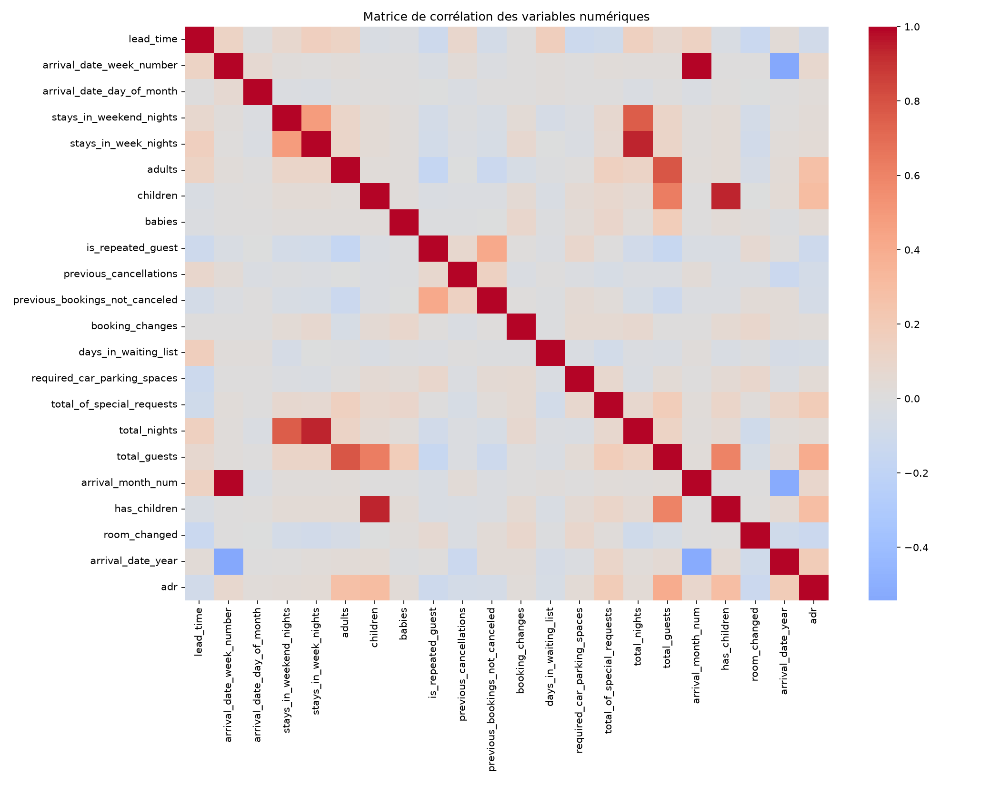
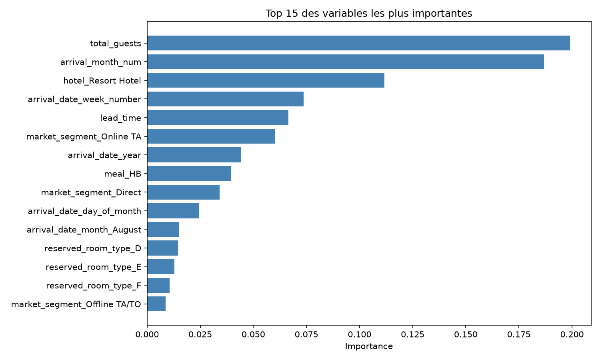
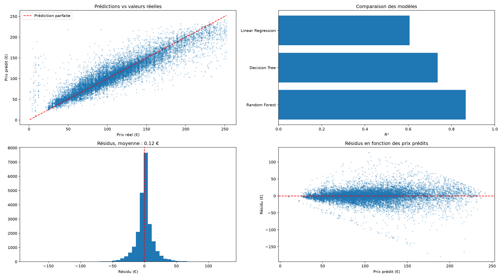

# Hotel Price Prediction & Revenue Management

> **Modélisation prédictive du tarif journalier moyen (ADR) sur près de 120 000 réservations hôtelières, du nettoyage des données jusqu'aux recommandations de Revenue Management.**


---

##  Contexte

Projet réalisé en trinôme dans le cadre du **cursus Master 1 à IMT-BS (cours INF 4002)**, sous Google Colab (novembre 2025). Il a ensuite été **restructuré individuellement en pipeline Python modulaire** (octobre 2026) : code découpé en modules réutilisables, versionné avec Git, et analyse approfondie des erreurs du modèle.

L'objectif est de **comprendre les leviers tarifaires** d'un groupe hôtelier (City Hotel vs Resort Hotel) et de **prédire le prix journalier moyen** (Average Daily Rate – ADR) à partir des caractéristiques d'une réservation. Au-delà de la performance statistique, l'analyse vise à fournir des **recommandations métier actionnables** pour le Revenue Management.

**Auteurs** : Jean ATTIE · Léo GAUTIER · Antoine DEMANGHON

---

##  Problématique

> *Quels sont les facteurs qui déterminent le prix d'une nuit d'hôtel, et peut-on le prédire de manière fiable pour optimiser la stratégie tarifaire ?*

Trois sous-questions structurent l'analyse :
1. Quelles variables influencent le plus l'ADR (saisonnalité, type d'hôtel, segment de clientèle) ?
2. Un modèle linéaire suffit-il, ou faut-il capter des relations non-linéaires ?
3. Quelle est la précision réellement atteignable, et quel est le coût d'erreur business ?

---

##  Dataset

| Caractéristique | Valeur |
|---|---|
| **Volume** | ~119 000 réservations |
| **Période** | 2015 – 2017 |
| **Types d'hôtels** | City Hotel & Resort Hotel |
| **Variable cible** | `adr` (Average Daily Rate, en €) |
| **Source** | [Hotel Booking Dataset – Kaggle](https://www.kaggle.com/datasets/saadharoon27/hotel-booking-dataset) |

> ℹ Le fichier contient 36 colonnes, dont `name`, `email`, `phone-number` et `credit_card` : ces données personnelles sont fictives et ne sont pas utilisées dans la modélisation.

---

## ⚙ Stack Technique

| Domaine | Outils |
|----|-----|
| **Langage** | Python 3.12 |
| **Manipulation de données** | Pandas, NumPy |
| **Visualisation** | Matplotlib, Seaborn |
| **Machine Learning** | Scikit-Learn (LinearRegression, DecisionTreeRegressor, RandomForestRegressor) |
| **Qualité de code** | Ruff (formatage et analyse statique), Git, pytest, GitHub Actions |
| **Environnement** | VS Code + WSL (Ubuntu), Jupyter Notebook ; Google Colab pour la version initiale |

---

##  Pipeline de Data Science

```
┌──────────────┐   ┌──────────────┐   ┌──────────────┐   ┌──────────────┐   ┌──────────────┐
│  1. Cleaning │ → │   2. EDA     │ → │ 3. Feature   │ → │ 4. Modeling  │ → │ 5. Evaluation│
│  & Preproc.  │   │  Saisonnalité│   │  Engineering │   │  3 modèles   │   │ R² / MAE /   │
│              │   │  Corrélations│   │  One-Hot enc.│   │  comparés    │   │  RMSE        │
└──────────────┘   └──────────────┘   └──────────────┘   └──────────────┘   └──────────────┘
```

### 1. Préprocessing
- Imputation des valeurs manquantes (`children`, `country`, `agent`, `company`)
- Suppression des réservations incohérentes (aucun client, ADR négatif ou supérieur à 1 000 €)
- Filtrage de la cible : ADR strictement positif et inférieur au 99e centile (252 €), pour écarter les tarifs extrêmes

### 2. Analyse exploratoire (EDA)
- Étude de la **saisonnalité** mensuelle de l'ADR
- **Matrice de corrélation** sur les variables numériques pour identifier les prédicteurs forts et la multicolinéarité
- Détection visuelle des outliers via boxplots

### 3. Feature Engineering
- Création de variables dérivées : `total_nights`, `total_guests`, `arrival_month_num`, `has_children`, `room_changed`
- **One-Hot Encoding** des variables catégorielles (`hotel`, `meal`, `market_segment`, `reserved_room_type`…)

### 4. Modélisation
Trois modèles entraînés sur le même découpage train/test (80/20, `random_state=42`) pour une comparaison équitable :
- **Linear Regression** — baseline interprétable
- **Decision Tree** — capture des non-linéarités
- **Random Forest** — réduction de la variance par bagging  (100 arbres)

### 5. Évaluation
- Métriques calculées sur le jeu de test : **R²**, **MAE** et **RMSE**
- Analyse des résidus : biais et dispersion selon le niveau de prix (voir « Analyse des résidus »)

---

##  Résultats

### Performance comparée des modèles

| Modèle | R² | MAE | RMSE | Lecture |
|---|:---:|:---:|:---:|---|
| Linear Regression | 0,61 | 20,28 € | 27,05 € | ❌ Insuffisant : relations non linéaires non captées |
| Decision Tree | 0,74 | 15,43 € | 22,16 € | ⚠️ Correct mais limité : un seul arbre de profondeur 10 manque de finesse (pas de surapprentissage : R² de 0,76 en entraînement contre 0,74 en test) |
| **Random Forest** | **0,87** | **9,56 €** | **15,78 €** | ✅ Modèle retenu : erreur moyenne inférieure à 10 € |

> Le Random Forest divise l'erreur moyenne par 2 (de 20,28 € à 9,56 €) et fait passer le R² de 0,61 à 0,87.


### Variables les plus prédictives (Random Forest)

| Rang | Variable | Importance |
|:---:|---|:---:|
| 🥇 | `total_guests` | 19,9 % |
| 🥈 | `arrival_month_num` | 18,7 % |
| 🥉 | `hotel_Resort Hotel` | 11,2 % |
| 4 | `arrival_date_week_number` | 7,4 % |
| 5 | `lead_time` | 6,7 % |
| 6 | `market_segment_Online TA` | 6,0 % |

>  **Insight métier** : le tarif est piloté avant tout par **la période de l'année** et **la composition du groupe**. La saisonnalité est même sous-estimée par ce classement : elle est répartie entre plusieurs variables corrélées (mois, numéro de semaine, jour du mois, mois d'août), qui pèsent ensemble environ 30 %. Ce sont deux leviers directement actionnables en Revenue Management.

---

##  Visualisations clés

Le pipeline (`python main.py`) génère trois figures dans le dossier `figures/`.

### Matrice de corrélation


Elle révèle les variables redondantes (le mois et le numéro de semaine sont presque parfaitement corrélés) et les liens linéaires avec le prix.

### Importance des variables (Random Forest)


### Diagnostic du modèle


Quatre graphiques : prédictions vs valeurs réelles, distribution des résidus, comparaison du R² des trois modèles, et résidus en fonction des prix prédits.

---

## Analyse des résidus

**Observation.** La dispersion des résidus augmente avec le prix prédit : leur écart-type passe de 9,5 € pour les chambres à moins de 60 € à 24 € pour celles à plus de 180 €.

**Explications possibles.**
- Les prix élevés sont plus rares : le modèle dispose de moins d'exemples pour apprendre.
- Les données ne contiennent pas toujours ce qui justifie un prix élevé (type de chambre, vue, forfait spécial).

**Un biais aux extrémités.** Par construction, le Random Forest tire ses prédictions vers le centre : il sous-estime les chambres dont le prix réel dépasse 200 € (résidu moyen de +25 €) et surestime celles à moins de 50 € (résidu moyen de -9 €).

**Vérification chiffrée.**

| Tranche de prix prédits | Écart-type des résidus | Rapporté au prix réel moyen | Nombre de réservations |
|---|:---:|:---:|:---:|
| Moins de 60 € | 9,5 € | 20,5 % | 2 729 |
| De 80 à 120 € | 14,2 € | 14,4 % | 9 297 |
| Plus de 180 € | 24,0 € | 11,8 % | 1 088 |

**Interprétation.** En valeur absolue, l'écart-type des résidus augmente avec le prix (de 9,5 € à 24 €), mais en valeur relative, il diminue (de 20,5 % à 11,8 % du prix réel moyen) : les chambres bon marché sont proportionnellement les moins bien prédites. Selon l'unité retenue, euros ou proportion, la conclusion n'est donc pas la même, voire opposée. Le choix dépend de l'enjeu métier :
- **En euros**, si la question est le revenu : sous-estimer de 24 € le prix d'une suite fait perdre plus d'argent que de se tromper de 9 € sur une petite chambre.
- **En proportion**, si la question est la perception du client ou la concurrence : une chambre à 45 € affichée 54 € paraît 20 % trop chère, et le client part chez le voisin.

**Choix de la métrique.** Notre étude porte sur le revenue management, dont l'objectif est de maximiser le revenu. Nous retenons donc la MAE, exprimée en euros, comme métrique principale. L'erreur relative vient en complément : elle montre que les chambres bon marché sont proportionnellement les moins bien prédites.

**Piste d'amélioration.** Quand les erreurs grandissent à peu près proportionnellement au prix, on modélise souvent le logarithme du prix plutôt que le prix lui-même.

---
## Conclusions

 **Un modèle non linéaire est indispensable** : avec les mêmes variables, la régression linéaire plafonne à un R² de 0,61, contre 0,87 pour le Random Forest.

 **Le Random Forest atteint une précision exploitable** (MAE ≈ 9,56 €), suffisante pour alimenter un outil d'aide à la décision tarifaire.
 
 **Trois leviers business émergent** : la saisonnalité, la taille du groupe et le type d'établissement.

 **Limites identifiées** :
- Le modèle est entraîné sur des tarifs compris entre 0 et 252 € : il ne sait pas prédire les prix plus élevés.
- Il sous-estime les chambres chères (+25 € en moyenne au-delà de 200 €) et surestime les moins chères (-9 € en dessous de 50 €).
- Il ne sait pas extrapoler l'année d'arrivée : une réservation postérieure à 2017 est traitée comme une réservation de 2017. Un réentraînement sur des données récentes est nécessaire, notamment pour intégrer la dynamique post-COVID.
- Certains tarifs premium (suites, forfaits spéciaux) ne sont pas expliqués par les variables disponibles.

**Pistes d'amélioration** :
- Modéliser le logarithme du prix, pour réduire l'erreur relative sur les chambres bon marché.
- Optimiser les hyperparamètres (par exemple `max_features`) par validation croisée.
- Tester un Gradient Boosting (XGBoost, LightGBM).

---

## Installation & Utilisation

### Prérequis
- Python 3.11 ou plus récent (projet testé avec Python 3.12)
- pip

### Installation

```bash
# Cloner le dépôt
git clone https://github.com/jeanattie02-web/Hotel-Revenue-Management-Analysis.git
cd Hotel-Revenue-Management-Analysis

# Créer et activer un environnement virtuel
python3 -m venv .venv
source .venv/bin/activate        # Windows : .venv\Scripts\activate

# Installer les dépendances
pip install -r requirements.txt
```

### Exécution

```bash
# Option 1 — Pipeline complet (recommandé)
python main.py

# Option 2 — Exploration interactive (notebook avant la restructuration)
jupyter notebook notebooks/Hotel-Booking.ipynb 
```

`python main.py` enchaîne toutes les étapes, du chargement des données à l'évaluation : il affiche le tableau comparatif des trois modèles et génère les trois figures dans `figures/`, en une dizaine de secondes.

---

##  Structure du projet

```
Hotel-Revenue-Management-Analysis/
├── data/
│   └── hotel_booking.csv          # Données brutes (Kaggle)
├── figures/                       # Figures générées par main.py
│   ├── 01_correlations_variables.png
│   ├── 02_importance_features_rf.png
│   └── 03_performance_models_rf.png
├── notebooks/
│   └── Hotel-Booking.ipynb        # Analyse exploratoire et rapport initial
├── src/
│   ├── __init__.py
│   ├── data.py                    # Chargement et nettoyage
│   ├── features.py                # Variables dérivées, filtrage et encodage
│   ├── models.py                  # Découpage train/test et entraînement
│   ├── evaluate.py                # Métriques et comparaison des modèles
│   └── plots.py                   # Graphiques
├── tests/ 
│   ├── test_data.py               # Tests du nettoyage et de la copie des données 
│   ├── test_features.py           # Tests de la création des nouvelles variables et de la copie 
├── main.py                        # Pipeline complet
├── requirements.txt
├── .gitignore
├── .github/
│   └── workflows/
│       └── tests.yml              # Lance les tests à chaque Pull Request (GitHub Actions)
├── pytest.ini                     # Configuration de pytest
└── README.md
```

---

## Méthodologie 

Approche **scientifique itérative** : chaque étape (cleaning → EDA → modélisation → évaluation) a été validée avant de passer à la suivante, avec retour en arrière si nécessaire. L'interprétation métier des résultats est intégrée à chaque palier plutôt que reportée à la fin. 

---
## Utilisation de l'IA générative

La restructuration du projet (2026) a été réalisée avec l'aide d'une IA générative (Claude), utilisée comme assistant pédagogique :
- **Rôle de l'IA** : explication des concepts, exercices de code guidés, relecture du code, proposition de structure et de rédaction pour la documentation.
- **Mon travail** : écriture et exécution du code étape par étape, débogage, vérifications chiffrées (analyse des résidus, contrôle du surapprentissage) et choix méthodologiques.
- **Vérification** : chaque résultat présenté a été reproduit en exécutant le pipeline (`python main.py`).
---

## Auteurs

| Nom | Contribution |
|---|---|
| **Jean ATTIE** | Data cleaning · EDA · Modélisation · Feature engineering · Restructuration modulaire (2026)|
| **Léo GAUTIER** | Évaluation · Visualisations |
| **Antoine DEMANGHON** | Préprocessing · Modélisation · Documentation |

---

##  Licence

Projet académique réalisé dans le cadre du cours **INF 4002 – IMT Business School (Master 1)**.


---

<p align="center">
  <i>Made with 🐍 Python at IMT Business School · 2025</i>
</p>
